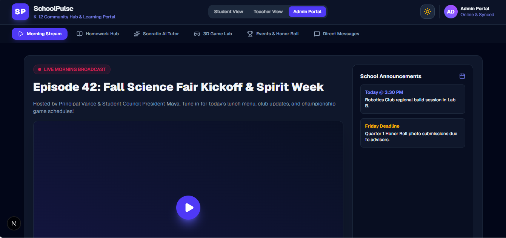
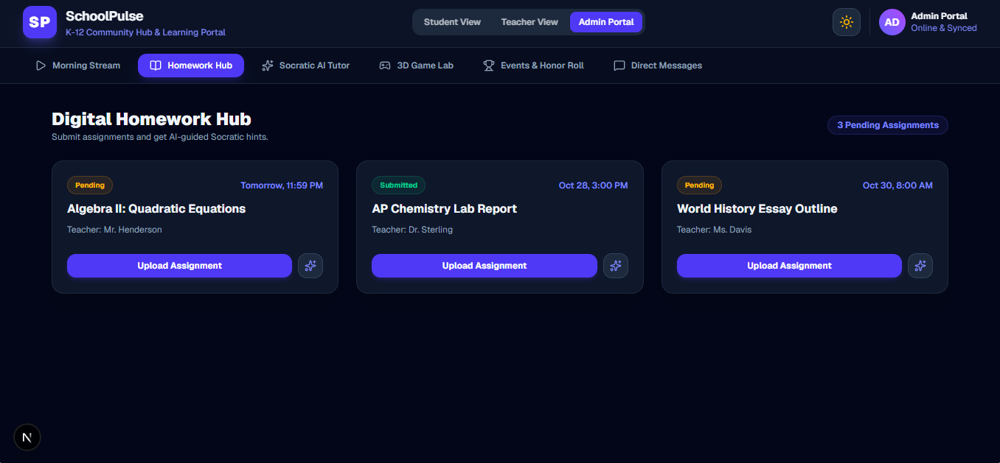
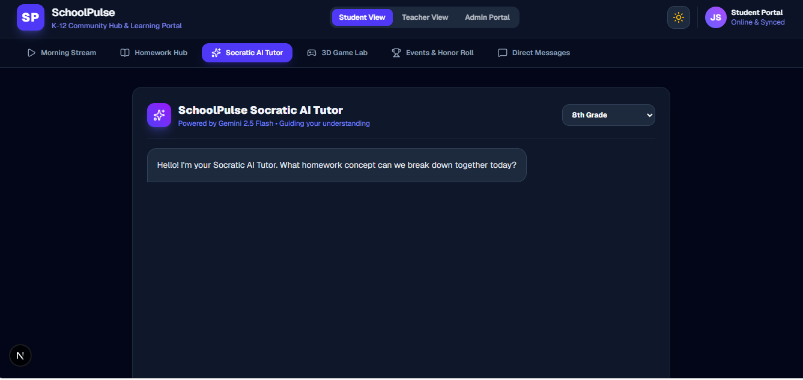

# SchoolPulse

A K-12 community hub and learning portal. One app for students, teachers, and admins — with a morning stream, homework help, a Socratic AI tutor, a 3D game lab, events, honor roll, and direct messages.

## Screenshots







## What it does

- **Morning Stream** — a live school broadcast view with announcements
- **Homework Hub** — submit assignments and get AI-guided Socratic hints (never direct answers)
- **Socratic AI Tutor** — an encouraging, patient tutor powered by Gemini 2.5 Flash that asks guided questions instead of handing over solutions, with grade levels from 6th grade through AP
- **3D Game Lab** — an immersive 3D simulation portal (launch a 3D chemistry sim)
- **Events & Honor Roll** — school events and the Principal's Honor Roll
- **Direct Messages** — student/teacher messaging
- **Role views** — Student View, Teacher View, and Admin Portal

## Tech stack

- **Framework:** Next.js 16 (App Router) + React 19 + TypeScript
- **Styling:** Tailwind CSS v4
- **Backend:** Firebase (Firestore + Auth)
- **AI:** Google Gemini 2.5 Flash via the `@google/genai` SDK
- **Icons:** lucide-react

## Run it locally

```bash
npm install
npm run dev
```

Open [http://localhost:3000](http://localhost:3000) in your browser.

Other commands:

```bash
npm run build   # production build
npm run start   # run the production build
npm run lint    # lint
```

## Environment variables

Create a `.env.local` file in the project root:

```
GEMINI_API_KEY=your-gemini-api-key
NEXT_PUBLIC_FIREBASE_API_KEY=your-firebase-api-key
NEXT_PUBLIC_FIREBASE_AUTH_DOMAIN=your-project.firebaseapp.com
NEXT_PUBLIC_FIREBASE_PROJECT_ID=your-project-id
NEXT_PUBLIC_FIREBASE_STORAGE_BUCKET=your-project.appspot.com
NEXT_PUBLIC_FIREBASE_MESSAGING_SENDER_ID=your-sender-id
NEXT_PUBLIC_FIREBASE_APP_ID=your-app-id
```

`GEMINI_API_KEY` stays server-side (it powers the AI tutor API route). Never commit `.env.local` to the repo.

## Project structure

```
app/
  page.tsx            # the whole SchoolPulse portal (all tabs + role views)
  layout.tsx          # root layout + fonts
  globals.css         # global styles
  api/aitutor/route.ts # Socratic AI tutor API (Gemini 2.5 Flash)
lib/
  firebase.ts         # Firebase app, Firestore + Auth setup
```

## Status

Live in local development. Built as a portfolio project — a working K-12 school app, not a deployed school system.
